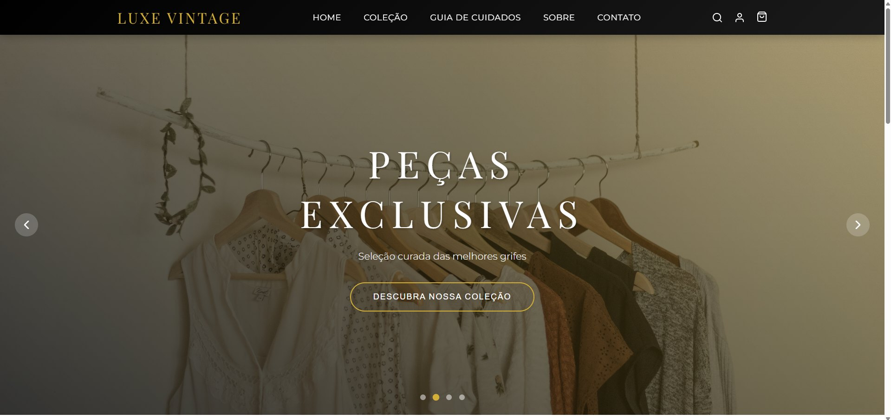
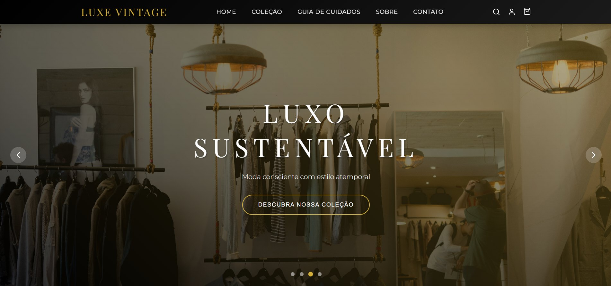
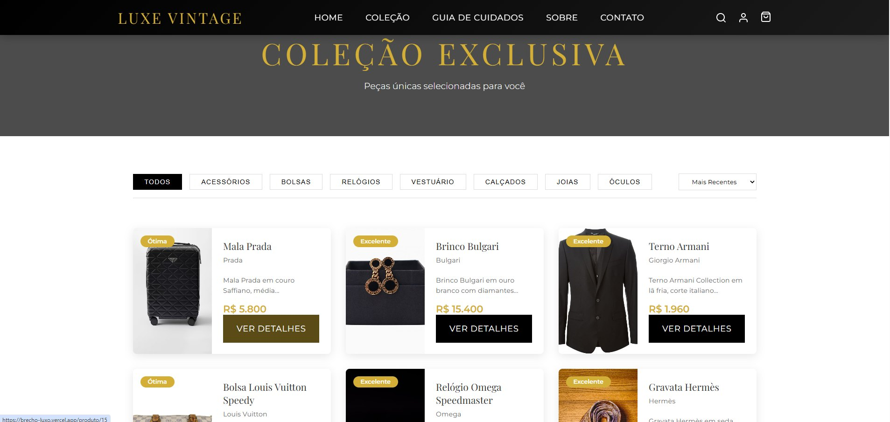
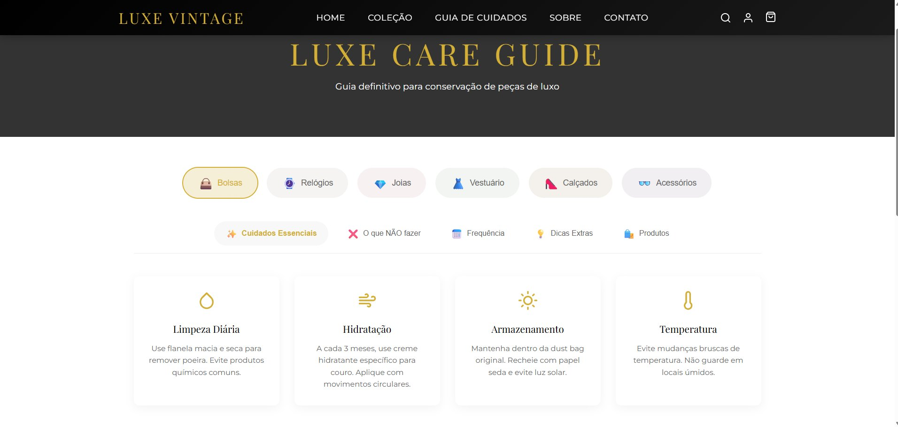
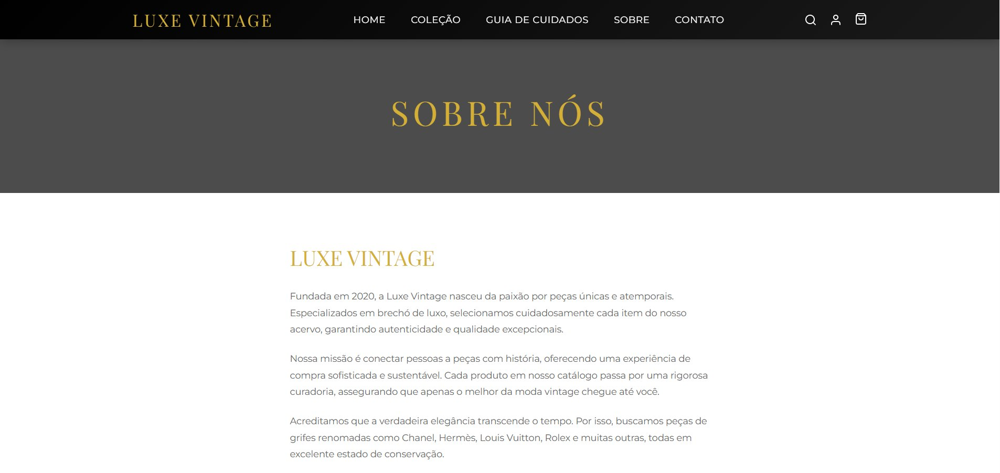
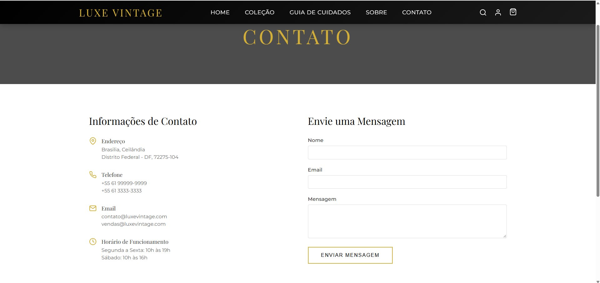

# 🛍️ Luxe Vintage | Brechó de Luxo — E-commerce Full Stack

**React 18 • JavaScript • React Router • Styled Components • Framer Motion • Node.js • Express • MySQL**

O **Luxe Vintage — Brechó de Luxo** é um projeto independente de e-commerce dedicado à apresentação de peças de moda e acessórios de luxo de segunda mão. A aplicação combina uma identidade visual sofisticada em preto e dourado com navegação por coleções, catálogo de produtos e conteúdo educativo sobre conservação de peças.

🌐 **[Acessar a demonstração online](https://brecho-luxo.vercel.app/)**

## 📸 Demonstração visual

As imagens abaixo foram capturadas da interface da aplicação.

### 🏠 Página inicial — Peças exclusivas

Banner principal com destaque para a curadoria de peças e chamada para explorar a coleção.

<p align="center"></p>

### ♻️ Página inicial — Luxo sustentável

Outra apresentação do carrossel, destacando moda consciente e estilo atemporal.

<p align="center"></p>

### ✨ Página inicial — Atemporalidade

Terceira apresentação visual do carrossel da página inicial.

<p align="center"></p>

### 🛍️ Coleção de produtos

Catálogo com categorias, ordenação, imagens, marcas, preços, estado de conservação e acesso aos detalhes dos produtos.

<p align="center"></p>

### 🧴 Guia de cuidados

Conteúdo interativo organizado por tipo de peça e assunto, com orientações de conservação.

<p align="center"></p>

### 📖 Sobre a marca

Página institucional que apresenta a proposta e a identidade da marca fictícia Luxe Vintage.

<p align="center"></p>

### ✉️ Contato

Informações de contato e formulário de mensagem apresentados na interface.

<p align="center"></p>

## 🎯 Objetivo

Desenvolver uma experiência de comércio eletrônico com **React**, combinando componentes de interface, navegação, apresentação de produtos e identidade visual própria, além de explorar uma estrutura tecnológica com serviços Node.js e banco de dados relacional.

## 🚀 Funcionalidades apresentadas

- **Página inicial** com carrossel de banners, mensagens de marca e acesso à coleção.
- **Catálogo de produtos** com categorias como acessórios, bolsas, relógios, vestuário, calçados, joias e óculos.
- **Listagem de produtos** com foto, marca, descrição resumida, preço, condição da peça e botão para visualizar detalhes.
- **Controles de filtragem e ordenação** apresentados na página da coleção.
- **Guia de cuidados** com seleção de categorias e orientações sobre conservação.
- **Página Sobre** com apresentação da proposta da Luxe Vintage.
- **Página Contato** com informações e formulário de mensagem.
- **Navegação** com acesso a coleção, guia de cuidados, páginas institucionais e ícones de busca, conta e sacola.

> As capturas comprovam a presença desses elementos na interface, mas não validam operações como autenticação, envio de mensagens, checkout ou pagamento.

## 🛠️ Tecnologias

| Camada | Tecnologias identificadas |
| --- | --- |
| Frontend | React 18, JavaScript |
| Rotas | React Router DOM |
| Estilização | Styled Components |
| Animações | Framer Motion |
| Interface | React Icons, React Hot Toast |
| Requisições HTTP | Axios |
| Backend | Node.js, Express |
| Banco de dados | MySQL, MySQL2 |
| Dependências de autenticação | JWT, bcryptjs |
| Configuração | CORS, dotenv |
| Hospedagem da demonstração | Vercel |
| Versionamento | Git e GitHub |

*As tecnologias foram identificadas no `package.json` disponibilizado para documentação. A execução ponta a ponta dos serviços não foi verificada.*

## 🧩 Arquitetura prevista

```text
Navegador
   │
   ▼
Interface React
   │
   ▼
Requisições HTTP / Axios
   │
   ▼
API Node.js + Express
   │
   ▼
Banco de dados MySQL
```

*Representação conceitual da stack identificada; não implica que todos os serviços estejam ativos na demonstração pública.*

## 💡 Competências demonstradas

Construção de interfaces com React, organização de páginas e componentes, estilização, navegação, experiência de catálogo, apresentação de informações de produtos e estruturação de um projeto com tecnologias de frontend e backend.

## 🌐 Testar o projeto

**[Abrir Luxe Vintage — Brechó de Luxo](https://brecho-luxo.vercel.app/)**

A demonstração pode apresentar limitações conforme a disponibilidade dos serviços hospedados.

## 🔒 Código-fonte

O código-fonte completo é mantido em repositório privado. Este repositório público apresenta a documentação, as capturas de tela e o link da demonstração, sem divulgar a implementação original.

## 👨‍💻 Desenvolvedor

**Tiago Martins de Oliveira**  
Técnico em Desenvolvimento de Sistemas • Desenvolvedor Full Stack

[GitHub](https://github.com/Massacral) · [LinkedIn](https://www.linkedin.com/in/massacral/) · [Portfólio](https://portfolio-tiago-cuxy.onrender.com/)

---

*Projeto independente desenvolvido para demonstração de competências em desenvolvimento web.*
